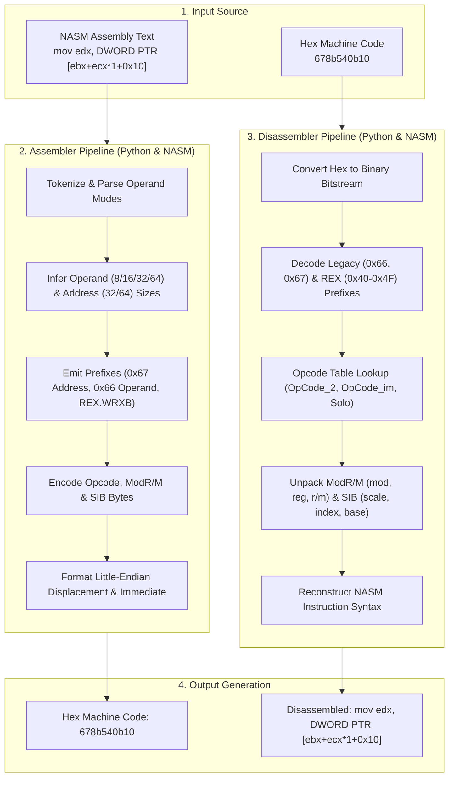

# x86_64 NASM Assembler & Disassembler

[](#automated-testing-suite)
[-blue.svg)](#features)
[](#architecture)
[](LICENSE.md)

A high-performance, format-compliant **NASM x86_64 Assembler and Disassembler** engineered in both **Python** and pure **x86_64 NASM Assembly**. The assembly implementation is translated from the Python reference model and simulates high-level dictionary lookups, array indexing, and string manipulation directly in assembly using POSIX system calls.

Fully supports 8-bit, 16-bit, 32-bit, and 64-bit operands, extended registers (`r8`–`r15`), legacy prefixes (`0x66`, `0x67`), REX prefixes (`0x40`–`0x4F`), ModR/M and SIB addressing modes, little-endian displacement, and immediate data encoding.

---

## Features

- **Dual-Engine Implementation**:
  - **Python Engine (`src/assembler.py`, `src/disassembler.py`)**: Clean, modular reference implementation with zero external dependencies. Supports programmatic importing, CLI argument execution, stdin streaming, and batch file translation.
  - **Assembly Engine (`src/assembler.asm`, `src/disassembler.asm`)**: Pure low-level NASM assembly targeting Linux ELF64 ABI. Uses direct kernel syscalls (`sys_read`, `sys_write`, `sys_open`, `sys_creat`, `sys_close`, `sys_exit`).
- **Dictionary Simulation in Assembly**: Replicates Python's dictionary lookups (`getValue`) and membership tests (`isIn`) using space-delimited string key-value tables and Carry Flag signaling in assembly.
- **Full Operand Width Coverage**: Encodes and decodes 8-bit (`BYTE`), 16-bit (`WORD`), 32-bit (`DWORD`), and 64-bit (`QWORD`) operands.
- **Extended Register Set**: Full support for standard registers (`rax`–`rdi`) and 64-bit extended registers (`r8`–`r15`), including sub-registers (`r8d`–`r15d`, `r8w`–`r15w`, `r8b`–`r15b`).
- **Rich Memory Addressing**:
  - Base-only: `[rax]`, `[rbx]`
  - Base + Displacement (8-bit signed / 32-bit signed): `[rax+0x10]`, `[rbx+0x12345678]`
  - SIB (Base + Index × Scale): `[rax+rcx*1]`, `[rdx+rsi*2]`, `[r8+r9*4]`, `[r10+r11*8]`
  - SIB + Displacement: `[rax+rcx*2+0x10]`, `[rbx+rdx*4+0x32345467]`
  - Pure Displacement: `[0x12345678]`
  - Index × Scale + Displacement: `[rcx*4+0x12345678]`
  - Special Base Register handling: `[rbp]`, `[ebp]`, `[rsp]`, `[esp]`.
- **Comprehensive Instruction Set**: Over 30 instruction families including data transfer, arithmetic, logic, bit scanning, shifts, stack operations, control flow, and system calls.
- **Automated Test Suite**: 26 unit and end-to-end integration tests verifying every instruction category, CLI modes, and complete roundtrip correctness (`instruction -> machine code -> instruction`).
- **Cross-Platform Build**: Universal `Makefile` that compiles natively on Linux or transparently via Docker on macOS (Apple Silicon / Intel).

---

## Architecture



For detailed architectural diagrams and data structure mapping, see [docs/architecture-overview.md](docs/architecture-overview.md).

---

## Supported Instructions

| Category | Mnemonics | Operands Supported |
|:---|:---|:---|
| **Data Movement** | `mov`, `xchg`, `xadd` | `reg, reg`, `reg, mem`, `mem, reg`, `reg, imm`, `mem, imm` |
| **Arithmetic** | `add`, `adc`, `sub`, `sbb`, `imul`, `idiv`, `inc`, `dec`, `neg` | `reg, reg`, `reg, mem`, `mem, reg`, `reg, imm`, `mem, imm`, unary |
| **Logical** | `and`, `or`, `xor`, `not`, `test`, `cmp` | `reg, reg`, `reg, mem`, `mem, reg`, `reg, imm`, `mem, imm` |
| **Bit Manipulation** | `bsf`, `bsr` | `reg, reg`, `reg, mem` |
| **Shifts** | `shl`, `shr` | `reg/mem, 1`, `reg/mem, cl`, `reg/mem, imm` |
| **Stack** | `push`, `pop` | `reg`, `mem`, `imm` |
| **Control Flow** | `jmp`, `jcc`, `call`, `ret` | Relative displacement (`call`, `jcc`), register/memory (`jmp`), stack pop (`ret imm16`) |
| **System & Flags** | `stc`, `clc`, `std`, `cld`, `syscall` | Zero-operand standalone instructions |

*Condition codes for `jcc`: `jo`, `jno`, `jb`, `jnae`, `jnb`, `jae`, `je`, `jz`, `jne`, `jnz`, `jbe`, `jna`, `jnbe`, `ja`, `js`, `jns`, `jp`, `jpe`, `jnp`, `jpo`, `jl`, `jnge`, `jnl`, `jge`, `jle`, `jng`, `jnle`, `jg`.*

---

## Input & Output Rules

### Input Syntax Rules
1. **Separators**: A single space separates the mnemonic and the first operand. Two operands are separated by a comma (e.g., `mov rax, rbx`).
2. **Memory Size**: Memory operands must explicitly declare their size (`BYTE`, `WORD`, `DWORD`, `QWORD`) followed by `PTR` and bracketed expressions (e.g., `mov edx, DWORD PTR [ebx+ecx*1+0x10]`).
3. **No Internal Spaces in Memory**: Brackets enclose compact expressions: `[base+index*scale+disp]`.
4. **Hexadecimal Notation**: Displacements and immediate values use hexadecimal format prefixed with `0x` (e.g., `0x10`, `0x32345467`).
5. **Casing**: Mnemonics, registers, and hex values are lowercase; memory size identifiers are uppercase (`BYTE`, `WORD`, `DWORD`, `QWORD`, `PTR`).
6. **Scale Multiplier**: When an index register is present, the scale factor is explicitly stated even if 1 (e.g., `[ebx+ecx*1]`).

### Output Syntax Rules
- Machine code is output in lowercase hexadecimal with leading zeros preserved and without a `0x` prefix (e.g., `4889d8`).
- Assembly disassembler produces standardized NASM-compliant syntax with brackets and size specifiers matching input rules.

---

## Directory Structure

The project layout is organized as follows:

```text
assembler-and-disassembler/
├── Makefile                     # Multi-platform build and test driver
├── README.md                    # Project documentation
├── LICENSE.md                   # MIT license
├── .gitignore                   # Git ignore specifications
├── docs/                        # Technical specifications & documentation
│   ├── architecture-overview.md # Dual-engine architectural specification
│   ├── instruction-formats.md   # x86_64 machine instruction encoding reference
│   └── intel-instruction-formats.pdf # Intel SDM Appendix B reference manual
├── scripts/                     # Automated utility and test runners
│   └── run-tests.sh             # Test suite execution script
├── src/                         # Core implementations
│   ├── common/                  # Shared assembly routines (console I/O, file operations, system constants)
│   │   ├── console-io.asm       # Console I/O routines (print_string, getc, etc.)
│   │   ├── file-io.asm          # POSIX file wrappers (file_create, sys_open)
│   │   └── system-constants.asm # Linux ELF64 syscall numbers and constants
│   ├── assembler.asm            # Assembly engine assembler
│   ├── disassembler.asm         # Assembly engine disassembler
│   ├── assembler.py             # Python reference assembler
│   └── disassembler.py          # Python reference disassembler
└── tests/                       # Automated test suite
    ├── test_assembler.py        # Assembler unit tests across all addressing modes
    ├── test_disassembler.py     # Disassembler unit tests
    ├── test_roundtrip.py        # Complete roundtrip validation tests
    └── test_cli.py              # CLI argument, pipe, and file integration tests
```

---

## Quick Start & Usage

### 1. Python CLI Usage

#### Direct CLI Argument
```bash
python3 src/assembler.py "mov rax, rbx"
# Output: 4889d8

python3 src/disassembler.py "4889d8"
# Output: mov rax,rbx
```

#### Standard Input (Pipe)
```bash
echo "mov edx, DWORD PTR [ebx+ecx*1+0x32345467]" | python3 src/assembler.py
# Output: 678b940b67543432

echo "678b940b67543432" | python3 src/disassembler.py
# Output: mov edx,DWORD PTR [ebx+ecx*1+0x32345467]
```

#### Batch File Translation
```bash
# Assemble entire file
python3 src/assembler.py -f instructions.txt

# Disassemble entire file
python3 src/disassembler.py -f machine_codes.txt
```

#### Programmatic Python Import
```python
from src.assembler import assemble
from src.disassembler import disassemble

# Assemble NASM instruction
machine_code = assemble("add eax, ecx")
print(machine_code)  # '01c8'

# Disassemble hexadecimal machine code
instruction = disassemble("01c8")
print(instruction)   # 'add eax,ecx'
```

---

### 2. Assembly Engine Usage

The assembly engine can be compiled natively on Linux x86_64, or via Docker on macOS (Apple Silicon / Intel).

#### Native Linux Assembly (NASM & LD)
```bash
make verify-asm
make build
```

#### Running the Assembly Assembler
When launched, `build/assembler` prompts for an input file path. It reads the instructions line by line and creates:
- `first-file.txt`: Binary bitstrings.
- `second-file.txt`: Hexadecimal machine code alongside original lines.

```bash
# Compile and run
./build/assembler
# Enter file name: input.txt
```

#### Running the Assembly Disassembler
When launched, `build/disassembler` reads binary bitstrings from an input file (such as `first-file.txt`) and outputs disassembled assembly into `first-file.txt`:
```bash
./build/disassembler
# Enter file name: first-file.txt
```

#### macOS / Docker Usage
On macOS (Apple Silicon), the Makefile uses Docker (`codeneomatrix/nasm`) to assemble and link ELF64 Linux binaries seamlessly:
```bash
make build
```

---

## Automated Testing Suite

The repository includes a comprehensive test suite covering all instruction variants, addressing modes, CLI arguments, and roundtrip verification:

```bash
# Run all tests using the Makefile
make test

# Or run using the script directly
./scripts/run-tests.sh

# Or run directly via Python unittest
python3 -m unittest discover -s tests -v
```

### Test Coverage Highlights
- **`test_assembler.py`**: Verifies solo opcodes, immediate return, register `mov`, arithmetic/logic, sign-extended and accumulator immediates, complex SIB/displacement modes, shifts, stack, unary ops, bit scans, and jumps.
- **`test_disassembler.py`**: Verifies prefix decoding (0x66, 0x67, REX), ModR/M and SIB unpacking, immediate sign recovery, and proper NASM syntax reconstruction.
- **`test_roundtrip.py`**: Asserts that `instruction -> assemble() -> disassemble() -> instruction` preserves identical semantics across all instruction categories.
- **`test_cli.py`**: Tests subprocess CLI arguments, stdin pipes, and multi-line file processing.

---

## References

- **Intel 64 and IA-32 Architectures Software Developer’s Manual**: [Appendix B: Instruction Formats and Encodings](docs/instruction-formats.md) (archived in [docs/intel-instruction-formats.pdf](docs/intel-instruction-formats.pdf)).
- **[Defuse x86 Online Assembler](https://defuse.ca/online-x86-assembler.htm)**: Cross-reference platform for NASM instruction validation.
- **[assembly-portfolio](https://github.com/mrmotabar/assembly-portfolio)**: Sibling repository providing low-level console, file, and system routines in `src/common/`.

---

## License

This project is licensed under the [MIT License](LICENSE.md) &copy; 2026 Mohammadreza Motabar.
