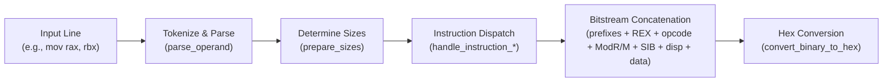
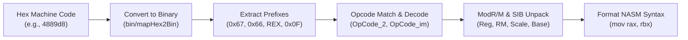

# Architecture Overview: Dual-Engine x86_64 Assembler & Disassembler

This document details the architectural design, data structures, and algorithmic correspondence between the **Python** reference implementation and the **NASM x86_64 Assembly** implementation.

---

## 1. System Philosophy

The project provides dual implementations of an x86_64 NASM assembler and disassembler:
1. **Python Engine (`src/assembler.py`, `src/disassembler.py`)**:
   - High-level reference model.
   - Ideal for rapid testing, automated validation, and script integration.
2. **NASM Assembly Engine (`src/assembler.asm`, `src/disassembler.asm`)**:
   - Pure low-level Linux x86_64 implementation with zero external C library dependencies.
   - Emulates high-level data structures (hash maps, lists, substring parsing) directly in assembly.

---

## 2. Emulating High-Level Data Structures in Assembly

One of the most notable features of the Assembly engine is how it mirrors Python's built-in data types:

| Python Concept | Assembly Implementation | Mechanism |
|:---|:---|:---|
| `table = {"rax": "000", ...}` | `register_table db "rax:000 rcx:001 ...", 0` | String table with `:` key-value pairs |
| `val = table[key]` | `call lookup_dictionary_value` | Scans for `key:` and extracts string value |
| `key in list` | `call check_token_membership` | Space-delimited token search returning Carry Flag (CF) |
| `tokens = s.split()` | `call extract_token_by_index` | Extracts N-th space-separated word from string |
| `s[start:end]` | `call extract_slice` | Memory pointer slicing into destination buffer |
| `H.zfill(len) -> little-endian` | `call normalize_value_to_binary` | Nibble extraction and little-endian byte ordering |
| `hex(int(bin, 2))` | `call convert_binary_to_hex` | Accumulates 4-bit nibbles and indexes `map_bin_to_hex` |

---

## 3. Assembler Processing Pipeline

Both engines follow an identical 5-stage transformation pipeline:

1. **Tokenize & Parse**:
   Separates mnemonic from comma-separated operands. Parses memory specifications (`[base+index*scale+disp]`).
2. **Determine Sizes**:
   Infers operand bit width (8, 16, 32, 64) and address width (32, 64). Emits `0x66` or `0x67` prefixes if required.
3. **Instruction Dispatch**:
   Routes instruction to the specific opcode handler (`handle_instruction_mov`, `handle_instruction_add`, etc.).
4. **Bitstream Assembly**:
   Constructs the full bitfield string in architectural sequence.
5. **Hexadecimal Formatting**:
   Converts binary bitstream to hexadecimal machine code.

---

## 4. Disassembler Processing Pipeline

---

## 5. File I/O Architecture (Assembly Engine)

The assembly implementation uses standard Linux POSIX system calls:
- `sys_open` (`2`): Opens the source instruction file (`SFD`).
- `sys_creat` (`85`): Creates:
  - `first-file.txt` (`D1FD`): Contains raw binary bitstrings.
  - `second-file.txt` (`D2FD`): Contains hexadecimal machine code alongside original NASM assembly.
- `sys_close` (`3`): Cleanly releases all file descriptors upon reaching EOF.
